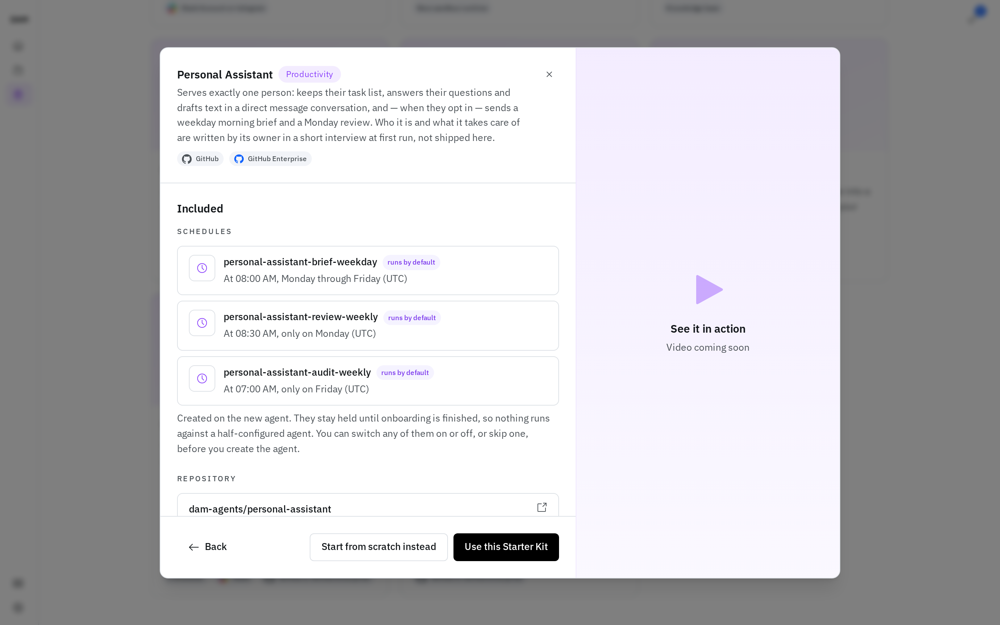
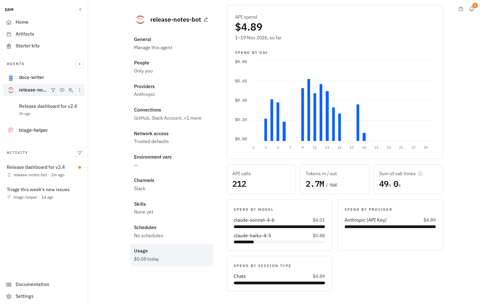

# Agents

An **agent** is a running AI assistant with its own persistent workspace, credential access, and configuration. It's the core thing you create and work with on the platform, and it's isolated from every other agent — its own compute pod, workspace, and network boundary.

## What You Get

When you create an agent, DAM provisions:

- **An isolated sandbox** — its own Linux environment running the AI harness
- **A persistent workspace** — a `~/work` directory that survives restarts and hibernation
- **A credential gateway** — a separate, hardened component that injects your tokens on the wire
- **Network isolation** — the agent can only reach services you explicitly allow

Each agent is independent. You can run several at once, each with a different harness and configuration.

## Lifecycle

| State | What's happening |
|-------|-----------------|
| **Starting** | The agent is starting up, either new or because something needs it. |
| **Preparing workspace** | A one-time workspace setup step is still running. The agent is already up, but you can't use it until that finishes. |
| **Running** | The agent is up. In the agents list and on the agent's own page this shows as **Working** (a turn in flight) or **Idle** (up, with nothing running). |
| **Idle** | Also what an agent shows once it has shut down after a quiet spell. Its workspace and configuration are kept, and it starts again the moment anything needs it. |
| **Waiting for memory** | There isn't room to start it yet. It starts once room frees up. See [Compute budget](#compute-budget-and-resources). |
| **Error** | The agent failed to start or hit a fatal issue. A start that was refused, for example because storage is full, reads **Can't start**. |

You never wake an agent by hand. Opening its chat, a schedule firing, or a message from a connected
channel starts it, with the usual short wait.

### Automatic Hibernation

Agents automatically hibernate after a period of inactivity (no active sessions, no pending triggers). When you open a chat or send a message from a connected channel, the agent wakes automatically.

An agent stays awake while it is **busy** — working a turn, with prompts queued, or waiting on
an approval — and also while any chat, terminal, or SSH connection is simply **open**, even with
nothing running. It only scales down once it's both idle and unconnected, so closing the tab, terminal,
or editor is what lets it idle down.

There's no per-agent setting for this: every agent sleeps after the same idle timeout.

### Background work and hibernation

**Background work holds the agent awake by itself.** When an agent starts a
job in the background, it reports that work, and while anything is outstanding the agent won't
hibernate underneath it — so closing the tab no longer kills what it left running. Nothing times that
hold out: an agent with reported work stays up until the work ends.

That covers work the agent's harness supervises, which is the usual case. A job **detached** from the
harness (`setsid`, `nohup`) is invisible to it, so it isn't holding the agent awake, and hibernation is
what will eventually end it. For those, **keep a terminal or SSH session open** for the duration. An
open connection pins the agent awake, and closing the tab or editor is what lets it idle down again.

Closing a chat tab doesn't stop a turn either — a running turn keeps the agent awake until it
finishes.

### What Survives Hibernation

| Persists | Lost |
|----------|------|
| Workspace files (`~/work`) | Running processes |
| Home directory (`$HOME`, except `~/.cache`) | In-memory state |
| Installed skills | Open terminal sessions |
| Session history | Files outside the persisted mounts (e.g. `/tmp`) |
| Connections and egress rules | Packages installed outside `$HOME` (apt, system-level) |

!!! tip "Bake long-term dependencies into an image"
    Anything your agent needs permanently — system packages, tools installed at runtime — should go
    into a custom image, or it will vanish on the next hibernation.

## Compute budget and resources

**Home** shows where you stand under **Agents**: how much of your agents' **Memory** and **Storage**
is in use, agent by agent. An agent that doesn't fit when it starts waits as **Waiting for memory** and
starts once room frees. Idle agents stop automatically to make room. To free room for good, delete an
agent you no longer use. **Request more** beside the card goes wherever your operator points it.

## Available Harnesses

Each agent runs one **harness** — the AI software inside the agent:

| Harness | Best For |
|---------|----------|
| Claude | Claude Code — general-purpose coding, debugging, refactoring (Anthropic) |
| Codex | OpenAI Codex coding agent |
| Pi | Pi coding agent with multi-LLM support |
| Bob | Bob shell agent (Anthropic, Mistral, Granite) |

## Knowledge bases and frameworks

A knowledge base isn't a separate kind of agent — it's an ordinary agent with a capability layered on.
It's set up to build and maintain a body of knowledge you chat with: feed it sources and it answers with
citations back to where the answer came from. You create one from a [starter kit](#starter-kits) under
**Knowledge**. See the [Building knowledge bases](../guides/building-knowledge-bases.md) guide.

Rather than write an optimization loop from scratch, you can run an established **framework**. Each is
offered as a [starter kit](#starter-kits) under **Research**, and each brings its own image — so you
create an agent from the kit and give it your brief in its first message, rather than pairing it with an
agent you already have. Point it at a target and a measurable objective — "evolve this function to run
faster on this input set" — and it authors the run, drives the framework, and reports the winner.

- **Nous** Hypothesis-driven campaigns against a target system it clones, builds, patches and measures.
- **OpenEvolve** Evolutionary code optimization — evolves programs against a fitness function you define.
- **ShinkaEvolve** Sample-efficient evolutionary program optimization, for when each evaluation is costly.
- **GEPA** Reflective prompt and text optimization, rather than optimization of code itself.
- **AdaEvolve** Multi-island adaptive code and algorithm optimization, from the SkyDiscover project.

Which of these your install offers is up to your operator, so the **Research** shelf on **Starter
Kits** is the list to trust — **EvoX**, a self-evolving optimizer from the same project as AdaEvolve,
ships switched off, for instance, and so does **K-Search**, for GPU kernel optimization. Each kit's page links its own documentation, and Nous has a guide of
its own: [Run Nous campaigns](../guides/run-nous.md).

## Managing agents

### Create

There are two ways to start, from **Home** or from the **+** beside **Agents** in the left sidebar:

- **Create agent** on Home, or **Blank agent** under the sidebar **+**: the agent is created straight
  away, on **Trusted defaults** network access, and you land in its chat. Pick its harness and model in
  the picker under the message box. Add connections, channels and everything else afterwards, from
  **Configure agent** (see [Configure](#configure)). If you haven't connected a model provider yet, the
  chat asks you to **Connect an LLM provider** first.
- **Browse starter kits** on Home, or **From a starter kit** under the sidebar **+**: start from a
  [starter kit](#starter-kits), which sets most of this up for you.

#### Starter kits

A **starter kit** is a ready-made agent configuration: a harness, skills, schedules, connections and
channels bundled together, sometimes with a repository of its own. **Starter kits** in the sidebar
lists what your install offers, grouped as **Software**, **Knowledge**, **Productivity** and
**Research**, and searchable. Each kit says who publishes it: **By DAM** with a check mark for the DAM
team's kits, or **By &lt;name&gt;** for a kit a user contributed. To start with no kit, pick **The
Generalist**, which needs no setup.

Open a kit to see exactly what it brings before you commit. Its window shows the harness and model it
runs on, the **Repository** it seeds your workspace from, and its skills. You don't pick a provider: the
platform uses one of yours that the kit can run on. Under **You'll set up** are the **Connections** it
needs, with required ones called out so you know what it can't work without, the **Schedules** it
registers — adjust or skip any of them — and the channels you can talk to it in. You can rename the
agent and change its avatar there too. Then click **Use this starter kit**.

**Network access** is shown too, read-only: the preset the agent starts on — the trusted defaults
unless the kit sets its own — and any rules the kit adds on top. A kit can ask for more than the
defaults, up to **Full web access**, so this is where you see that before you create. It's a starting
point, not a lock: you change it in the agent's **Network access** settings afterwards, where the kit's
rules are marked *from the starter kit*.

A kit usually opens a **first session** as soon as the agent exists, where the agent asks you for the
handful of things only you can supply and does the rest itself. While that's unfinished the agent
carries an **Onboarding** badge — **Onboarding 2/5** once it knows how many steps there are — and a bar
above the message box tracks the same list. **Any schedules the kit registered are held until the agent
marks onboarding complete**, so nothing fires against a half-configured agent.

Afterwards it's an ordinary agent, listed on **Home** with the rest, carrying a badge naming the kit it
came from.

**When the kit moves on.** A kit that seeds a repository can improve after you've created from it. When
it has, the agent carries a **Kit update** tag in the agents list, and its chat shows a bar above the
message box saying the kit has a newer version. Hover **Update** to see what changed, or click it to open
a session where the agent walks you through the changes and asks which to take — including where the
update touches a file you've edited. Your own edits stay as local changes: the agent is told never to
commit or push them. **Skip this version** hides the offer until the kit moves again, and an update
you've started but not finished offers **Continue update** or **Start again**. Nothing is offered while
the agent is still onboarding.

!!! note "Which kits you see is up to your operator"
    The catalogue is configured per install and can move without a platform release, so treat the list
    on your own **Starter kits** page as the authority. **The Generalist** is always there, even when
    an install lists no other kits.

To import a kit for yourself from its link, or to contribute a kit to **Starter kits** for everyone, see
[Create your own starter kit](../guides/create-starter-kit.md#share-it).

<figure class="tour-shot" markdown>

<figcaption>A kit's detail page, before you create anything.</figcaption>
</figure>

### Configure

**Configure agent** — the wrench icon on the agent's row on Home and in the sidebar, or the button by
the agent's name in its chat — opens the agent's page. Its left nav has these sections:

- **General** — the agent's description; the ways in (see [below](#ways-in)); its **Model settings**
  where the harness has them; and **Manage**, with **Restart** and **Delete**.
- **People** — the people who can use and change this agent with you. You stay its owner.
- **Providers** — which of your connected model providers the agent can use, and its **Default
  model**, **Model for channels** and **Model for schedules** (see
  [Sessions](sessions.md#model-settings)).
- **Connections** — link GitHub, API keys, and other credentials
- **Network access** — which external services it may reach
- **Environment vars** — plain-text configuration variables; keep secrets in Connections
- **Channels** — connect the agent to Slack channels or Telegram chats (see
  [Slack](../integrations/slack.md) and [Telegram](../integrations/telegram.md))
- **Skills** — install or remove capabilities
- **Schedules** — run recurring tasks
- **Usage** — this agent's model spend, broken down by model and by day. It includes work the agent delegated to other agents.

The image is fixed at creation — the only change to it is the [update](#updating-the-image) below.

<figure class="tour-shot" markdown>

<figcaption>**Usage** for one agent.</figcaption>
</figure>

### Ways in

**Chat is the default way in, and it's one click.** Clicking an agent on Home or in the sidebar opens
its chat, and starts the agent first if it's asleep. **General** on the agent's page has a **Chat**
entry back the other way.

The other ways in sit **under the message box on a new session**, where a session has no messages yet,
and on the agent's **General** page:

| Option | What it does |
|--------|--------------|
| **Web terminal** | Opens a terminal in the browser, running the harness you pick, or **Shell** for a plain login shell |
| **CLI and SSH** | Shows copyable `dam chat` and `dam ssh connect` commands for your own terminal |
| **VS Code and Zed** | Shows copyable `dam ssh connect` commands for either editor — see the [VS Code/Zed (SSH) guide](../integrations/vs-code-zed-ssh.md) |
| **Slack** / **Telegram** | Shows how to connect the agent to a channel, where a messenger is set up |

Both command dialogs link the CLI quickstart, so a first-time setup is one hop away. The **New session**
icon on an agent's row in the sidebar opens a chat session directly. Start a terminal from the options
above instead.

### Restart

**Restart**, under **Manage** on the agent's **General** page, recreates the agent on its current
settings. The workspace survives — see [What Survives Hibernation](#what-survives-hibernation). Reach
for it when one is wedged. If an agent can't start, its chat says why and offers **Start agent** or
**Restart agent**; when starting takes longer than usual, it says that too.

If an agent restarts on its own while you have DAM open, a notice says so, naming the cause where
it's known: one that ran out of memory says so; one that ran out of storage says so and suggests deleting
files it no longer needs or requesting more; otherwise it says the agent crashed and restarted. You're
told once per restart, and not afterwards about a restart that happened while you were away.

### Updating the image

When the template an agent was created from moves on, an **Update** button appears — in the agent's
page header, and on its row in the agents list. Hover it to see that an update is available, with a
**See what changed** link where the harness publishes release notes; click it to confirm and apply.

Applying changes only the image. An agent that's asleep, or waiting for memory, applies it the
next time it starts; anything else restarts to apply it, so in-flight work is interrupted. The
confirmation tells you which case you're in.

If you don't apply it, DAM moves an agent made from a template onto the template's current image by
itself, without interrupting it: a sleeping agent at once, a running one once it next goes idle. If the
agent won't start on the new image, DAM moves it back and doesn't try that image again. An agent made
from a custom image or a starter kit is never moved.

An agent can also be behind in a way that costs it something silently. Where its runtime is too old to
accept configuration you granted it — network access, credentials, files, MCP servers, skills — it
carries a **Missing config** warning badge on its row and in its chat header, and a notice above the
conversation says which kinds it's running without. Where an image update exists, **Update** is offered
right there; where none is yet, it tells you that instead, so the warning is never something you can act
on and fail.

### Delete

**Delete**, under **Manage** on the agent's **General** page, permanently removes the agent's workspace, sessions, and configuration. This cannot be undone.

!!! warning "Deleting an agent destroys all workspace files. If you have important work, download it or push it to a remote repository first."
