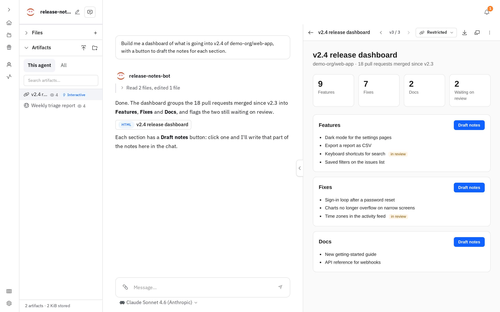
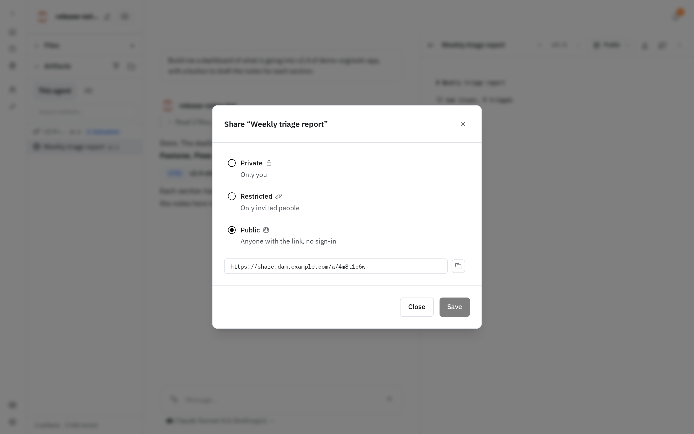

# Artifacts

An **artifact** is a finished output your agent publishes to keep — a report, a dashboard, a
generated page, a data file. Unlike a file in the agent workspace, an artifact **outlives the
agent that made it**: delete the agent and the artifact stays in your library.

Artifacts are yours, not the agent's. The library is owner-scoped — you see your own.

## What an artifact can be

| Kind | Renders as |
|------|-----------|
| `html` | A live page |
| `jsx` | A live React component |
| `markdown` | Formatted prose |
| `code` | Syntax-highlighted source |
| `text` | Plain text |
| `binary` | Anything else — downloadable (images, PDFs, archives, datasets) |

The kind is detected from the file name and content when the agent doesn't set it. HTML and JSX
artifacts render and run, which is what makes a dashboard or an interactive report work — those
aren't separate kinds, just things you author as HTML, JSX, or markdown.

!!! note "Self-contained only"
    A rendered artifact is a single file. Anything that exists only inside the agent — a companion
    file, an installed package, a running server — won't exist for a viewer. Resources must be
    inlined or referenced by absolute public URL.

    A JSX artifact must export its React component as the **default export**, and it pulls React and
    charting libraries from public CDNs in the viewer's browser — so it needs the viewer to be
    online.

Non-binary artifacts — text, code, markdown, HTML and JSX — over **10 MB** aren't rendered; they're
offered as a download instead. Of the binary kinds, only images preview inline, and a shared image
streams at any size. Publishing itself is capped at **50 MB** per artifact by default; your operator
can set a different ceiling.

## Publishing one

Ask the agent for the output you want and to publish it. It has built-in tools for the whole
lifecycle — creating, updating, organizing into folders, and setting sharing — so nothing needs
configuring first. Text content up to **2 MB** is sent inline; anything larger or binary is uploaded
directly, so big files never pass through the conversation.

Agents can read back what they published, at its current or a past version. An agent sees only its
own artifacts: another agent's, and anything you uploaded, reads as not found to it.

<figure class="tour-shot" markdown>

<figcaption>An artifact open beside the conversation.</figcaption>
</figure>

When an agent publishes something, it links it in chat — opening that link previews the artifact
beside the conversation, so you can read a report or click through a dashboard without leaving the
session. The panel's top bar keeps the main actions: the version switcher, the sharing button (it shows who can open the artifact: **Private**, **Restricted** or **Public**), **Download** and
**Open in new tab**, which opens the artifact on a page of its own in the app, private ones included.
The rest are under **⋮**, including **Rename**, **Move**, **Edit source**, **Start a new session**,
**View source**, **Set expiration** and **Delete artifact**.

You can also upload a file yourself with **Upload artifact**, or publish a file straight out of an agent's
workspace — see [the File Manager](file-manager.md#publishing-a-file-as-an-artifact).

Everything collects in the **Artifacts** destination, searchable by title and file name. Each
agent also shows the artifacts it produced.

An agent can only publish into its own owner's library, and attribution can't be spoofed.

## Interactive pages

An HTML artifact can be **interactive**: its buttons talk to the agent that published it. Ask the
agent for one — "a dashboard of my open issues with a button to triage each one" — and it builds the
page and marks it interactive. It shows an **Interactive** badge in the library.

An interactive page can do two things:

- **Send the agent a prompt.** A button types a request into the chat for you. This works in the
  docked panel inside that agent's chat, where the open conversation gets the prompt and the reply
  shows up there as usual. Opened anywhere else, a plain button tells you to *open this artifact in
  its agent's chat to use this button*. A page can also be built to send each prompt to a session of
  its own; that session runs unattended, so nobody answers its permission prompts.
- **Read and change the agent's data.** The page can ask a small server the agent runs in its own
  sandbox, so the page and the agent work from the same state — a to-do list you tick off in the
  page and the agent reads back, for example. The agent starts that server itself. After the agent
  has been idle and asleep, the page gets no answer until the agent starts it again — ask the agent
  in chat.

**Set model** in the page's **⋯** menu picks the model the sessions its prompts open run on.
**Use agent default** clears the pick, and the page follows the agent's model for channels again.

Only the latest version of a page can send prompts or requests; older versions can't. To share an
interactive page, see [Sharing](#sharing): it can never be public.

## Editing one yourself

You don't have to ask the agent to fix a typo. **Edit source** — in an artifact's **⋯** menu, and in the
artifact once it's open — edits the text in place and saves it as a **new version**, exactly as an agent's
own update would: same share link, same version history.

Three things make an artifact editable, and the menu simply leaves **Edit source** out otherwise:

- It's **text** — anything but a binary file.
- It's the **current** version. Pin an older one to read it and editing is off; come back to the latest
  to change it.
- It's **small enough** to send back inline. A large artifact you can still read is offered as too large
  to edit here.

If someone else — or the agent — published a new version while you were typing, your save **stops and
tells you** rather than quietly burying theirs: *Overwrite the newer version?* Say yes and yours becomes the latest; say no and nothing is saved, so you can reopen the
newer one and redo your edit on top. An unsaved edit is guarded too: navigating away asks before
discarding it.

## Versions

Updating an artifact's content publishes a **new version** rather than overwriting it. The artifact
keeps its identity: **the share link stays the same**, and it always shows the **current** version.
Someone with the link can't page back through older ones — a link that names an older version opens
on the current one. The history stays with you in the app, where the version list shows each one's
age, its size, and who published it — **You**, or the agent's name.

Editing only metadata — title, file name, folder — changes it in place without a new version.

An artifact's kind is settled when it's created. Renaming the file or publishing different content
never changes it, because the share link outlives every version — publish a new artifact when the
content is a different kind of file.

## Folders

Group artifacts into folders to keep a library browsable. Create one with **New folder** at the top of the
Artifacts list, beside **Upload artifact**. Folders are a **single flat level** — no nesting.
Deleting a folder does **not** delete the artifacts inside it; they become ungrouped.

File something into one with **Move** in its **⋯** menu, or drag the row onto the folder.
**Rename** in the same menu changes the title.

Your folders show up wherever an agent's artifacts are listed, not just on the library page: the
**Artifacts** panel beside a chat, and the **Artifacts** section on the agent's own page, both group into
the same collapsible folders with a count on each. Two things about those two places are worth knowing,
because they're what makes a folder look wrong when it isn't:

- The count is **that agent's** artifacts, not the folder's whole contents — the same folder shows
  different numbers beside two different agents, and anything you filed there from elsewhere isn't
  counted.
- Beside a chat the panel has two tabs, **This agent** and **All**. **This agent** lists only the
  folders holding that agent's artifacts, and every folder appears while you drag a row, so there's
  always somewhere to drop it. **All** lists every folder you've made. You can drag an artifact into a
  folder straight from the chat panel without opening the library.

The sections beside a chat — **Files** and **Artifacts** — each remember whether you collapsed them, so the sidebar comes back the way you had it. Where two of them
are open, the divider between them can be dragged to change how they share the height, and that's
remembered too. A panel won't shrink past a readable minimum, and a collapsed panel has no divider.

## Picking work back up from one

An artifact is usually the end of a piece of work, but it's a reasonable place to start the next one.
**Start a new session** — in the row's **⋯** menu, and in the open artifact's **⋮** menu
while you're on the current version — opens a fresh chat **with the agent that published it**, with a
reference to the artifact already in the message box.

Nothing runs until you send: you read the line, add what you want done, and send it yourself. An artifact
you **uploaded** has no publishing agent, so it doesn't offer the action at all.

!!! note "An empty library"
    Until you have an artifact, the Artifacts page shows what one looks like, with **Ask an agent for
    one** and **Upload artifact**.

## Sharing

<figure class="tour-shot" markdown>

<figcaption>The sharing dialog.</figcaption>
</figure>

Artifacts start **private**. Every row starts with an icon for who can open it (hover for **Private**,
**Restricted** or **Public**), and **the icon is the control**: click it to open the sharing dialog. **Share** in the
artifact's **⋯** menu and a **Share** button in the opened artifact get you to the same place. The link is
served from a separate share domain, so a shared artifact can never reach your DAM session. The dialog's
**Share link** field copies the link.

The dialog offers three choices for who can open it:

| Choice | Who can open it |
|--------|-----------------|
| **Private** | Only you — no link |
| **Restricted** | Only invited people, who sign in first |
| **Public** | Anyone with the link |

**Restricted** shares with people you name. Add each one's email address, and a visitor has to sign in
before the artifact renders; anyone whose signed-in email isn't on the list gets a plain no-access page
offering to switch account. Add nobody and the link opens for you alone. The list holds email
addresses rather than DAM accounts, so you can invite someone who has never signed in — but they do
need an account your organization's identity provider admits, since an email on the list doesn't
create one.

An agent can share an artifact with named people too, when you ask, and add or remove viewers — and so
can `dam artifact share`. But a restricted artifact stays restricted there: only this dialog makes it
private or public again.

An **interactive** page — one whose buttons can ask its agent to do something — carries an
**Interactive** badge and can **never be public**. Share it **Restricted**, and the people you name can
use its buttons too, acting through your agent and your accounts. Only you can add people to an interactive page's list, in this dialog. A viewer's
prompt starts a session of their own on your agent, named after them and the page, so you can see
who asked for what; they see only the page, not the agent's reply. The dialog warns you that viewers
can read and change the agent's data and that the agent sees their email.

!!! warning "A public link is the access control"
    A **public** share URL contains an unguessable random token, and **that token is the only thing
    protecting it**. Anyone who has the link can view the artifact — no sign-in and **no password
    option**. Treat a public link as public: guarding it is up to you.

    Sending it to an external service publishes it. It may be cached or indexed even if you later
    make the artifact private. Choose **Restricted** instead where you need to know who's reading.

Turning visibility back to private disables the link immediately.

Folders get a public page automatically once something inside them is shared — it lists only the
artifacts that are **themselves shared**. **Copy folder link** in the folder's **⋯** menu gives you
the URL, and stays disabled until at least one artifact inside is public.

Each artifact records **who published it** (which agent, or you if you uploaded it) and a **view
count** of public renders. The count is a bare number — no viewer identity or timestamps — and
in-app previews don't add to it.

!!! note "Shared HTML and JSX is live code"
    Rendered artifacts execute as authored — the platform doesn't sanitize HTML or JSX. That's what
    makes interactive dashboards work, and it's why you should only share content you trust.

## Expiry deletes the artifact

An expiry is **retention, not link lifetime**. This is the one thing worth reading twice:

!!! danger "An expired artifact is permanently deleted"
    Expiry applies to the artifact itself, **regardless of visibility** — a *private* artifact with
    an expiry is deleted too, and making a public artifact private again does **not** cancel its
    expiry. It is not just the share link switching off.

    Once the expiry passes, the link reports itself as expired and you can still renew it. After a
    **7-day grace period** the content is permanently deleted, every version with it.

Because it's retention rather than sharing, it lives apart from the share link: **Set expiration** in an
artifact's **⋯** menu offers **Never delete**, *Delete in 1 hour*, *1 day*, *7 days*, or *30 days* —
plus **Keep current date** once one is set. It applies to a private artifact just as much as a public
one, so you can schedule a cleanup without ever sharing the thing.

Deleting an artifact is also permanent — all versions go, and the share link dies with them.
