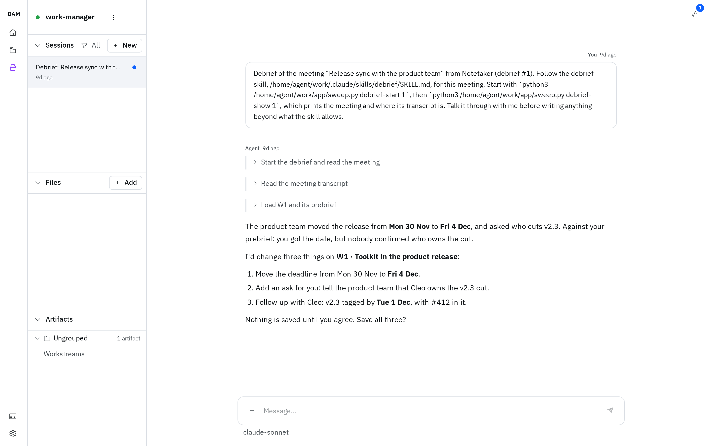

# Quickstart

Create your first agent in the cloud in minutes.

Prefer the command line? [Jump to CLI quickstart](#cli).

!!! note "This quickstart uses the IBM hosted deployment"
    The hosted deployment requires IBM VPN access.

    Running your own deployment? Use its URL and sign-in instead, and the steps are the same. See the
    [deployment guide](https://github.com/dam-agents/dam#run-your-own){:target="_blank"} to set one up.

## Web UI

### Step 1: Log In

Navigate to [ibm.biz/dam-agents](https://ibm.biz/dam-agents){:target="_blank"} and sign in with your IBM SSO credentials.

### Step 2: Create an Agent

Go to **Home** and click **Create agent**. Your agent is created straight away, and you land in its chat.

1. **Provider** — on the IBM hosted deployment there's nothing to connect: an agent with no provider of
   its own runs on CurveBender, IBM-hosted open-source models, and a notice above the message box says
   so. Self-hosting without a shared provider? The chat asks you to **Connect an LLM provider** first.
2. **Harness and model** — the picker under the message box shows what this chat runs on. To follow
   along with Claude Code, open it and pick **Claude** and a model.
3. **Connections** *(optional)* — to work against your repos, open **Configure agent** and add
   **GitHub** (for `github.com`) or **GitHub Enterprise** (for an Enterprise host, such as
   `github.ibm.com` for IBMers) under **Connections**, so it can clone, push branches, and open PRs.

Everything else can be left as it is and changed later.

!!! note
    Want Claude or another model that CurveBender doesn't serve? See [Create your LiteLLM key](../reference/litellm-key.md) —
    it covers which proxy to use and how to scope the key.

!!! tip "Or skip the choices entirely"
    **Browse starter kits** on Home (**Start from a kit** on a brand-new account) offers ready-made agents — a code reviewer, a knowledge base, a
    personal assistant — each bringing its own skills, schedules and connections, and each walking you
    through what it needs in its first message. See [starter kits](../core-concepts/agents.md#starter-kits).

### Step 3: Start Working

<figure class="tour-shot" markdown>

<figcaption>The chat. Each step the agent takes shows as a line you can expand.</figcaption>
</figure>


Type your first message:

```
Clone github.com/my-org/my-project and give me a summary
of the codebase architecture.
```

Or, on a session with no messages yet, use **Web terminal** under the message box and pick **Claude**
to launch the full Claude Code interactive TUI.

!!! tip "Want the full tour?"
    This gets you one working agent. To see the rest of the platform — connections, skills, schedules,
    Slack, artifacts, and more — built up one capability at a time, take the **[DAM new user tour](tour.md)**.

---

## CLI

### Step 1: Install the CLI

```bash
npm install -g @dam-agents/cli
```

Requires Node 20 or later.

### Step 2: Configure and Log In

```bash
dam config set server https://dam.res.ibm.com/
dam auth login
```

That's the IBM hosted deployment. On your own deployment, use its URL instead.

A browser window opens to authenticate. The CLI prints a user code — confirm it in the browser to
complete login. Pass `--no-browser` if you'd rather open the URL yourself.

### Step 3: Create a Claude Code Agent

Scripted. `--provider` names a model-provider connection by id or unique name (list them with
`dam connection list`); leave it off and DAM grants your preferred provider. `--harness claude-code`
starts it on Claude Code; leave it off and it starts on your default harness. Each session can pick
another harness:

```bash
dam agent create my-agent --provider "My provider" --harness claude-code
```

Wait for it to reach running state:

```bash
dam agent create my-agent --provider "My provider" --harness claude-code --wait
```

An unknown, ambiguous or non-provider `--provider` fails **before** any agent is created, so a
wrong flag costs you nothing but the error.

Or run the interactive setup, which walks you through the name, template selection, and credentials:

```bash
dam agent create-interactive
```

### Step 4: Start Working

Attach your terminal to the agent:

```bash
dam chat my-agent
```

You're now in the Claude Code interactive TUI — the same experience as running `claude` locally, but persistent in the cloud. Use slash commands, approve tool calls, and work as normal.

To reattach later:

```bash
dam chat my-agent --continue
```

### Step 5: Open in Your IDE (optional)

Prefer to work in your editor? Open the agent's workspace in **VS Code** or **Zed** over SSH:

```bash
dam ssh connect my-agent -x code    # or: -x zed
```

This gives you a Remote-SSH window into the running agent — edit files, run the terminal, and debug with the agent's full environment behind it. See the [VS Code/Zed (SSH) guide](../integrations/vs-code-zed-ssh.md) for prerequisites and details.

### Other Useful Commands

```bash
dam agent list                 # List your agents
dam agent get my-agent         # Show agent details
dam session list my-agent      # List sessions
```

!!! tip "Want the full tour?"
    This gets you one working agent. To see the rest of the platform — connections, skills, schedules,
    Slack, artifacts, and more — built up one capability at a time, take the **[DAM new user tour](tour.md)**.

---

## Next Steps

!!! tip "Stuck? (IBMers)"
    Ask in [**#dam-community**](https://ibm.enterprise.slack.com/archives/C0B3F03NB24){:target="_blank"} on IBM Slack. If something stops working,
    check [ibm.biz/dam-status](https://ibm.biz/dam-status){:target="_blank"} to see whether it's a known problem.

- **[Build a knowledge base](../guides/building-knowledge-bases.md)** — a personal brain, a project base, or a team's memory you can ask
- **[Run code reviews automatically](../guides/code-review.md)** — set up an agent that reviews every PR
- **[Add Slack](../integrations/slack.md)** — let your team interact with shared agents
- **[Schedule tasks](../core-concepts/schedules.md)** — run agents on a timer with no human in the loop
