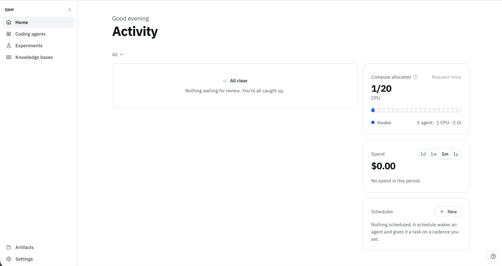
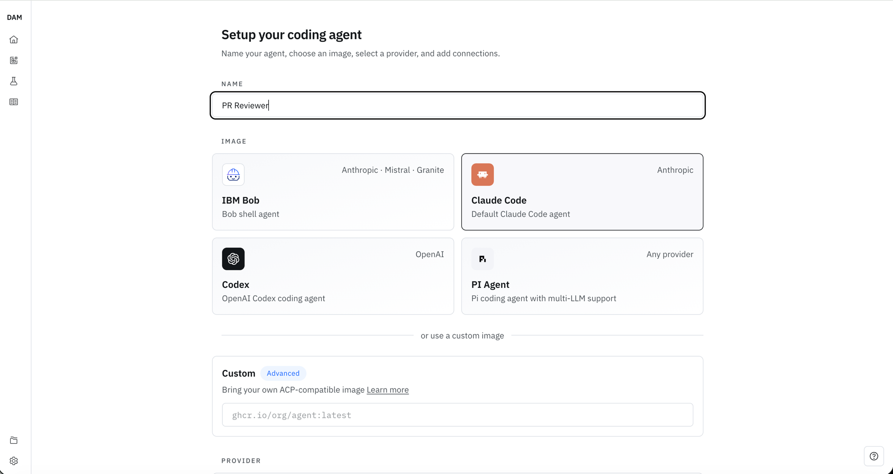
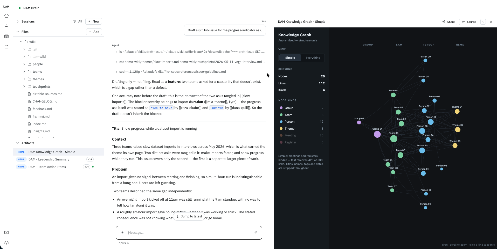

# DAM new user tour

Welcome to DAM. This tour gives you a quick look at what you can do with DAM and how the pieces fit
together. We'll start at Home, then explore agents and knowledge bases.

## Start on the home page

When you sign in, you land on **Home** — your agents, with **Compute allocated** and **Spend** at a
glance, and a banner whenever an approval is waiting on you. Everything else going on — approvals,
sessions in progress, ones with something new — collects in **Activity**, behind the **Activity** button at
the top right of every page. (On a brand-new account with no agents yet, Home is
a welcome that puts you straight into creating your first one instead.)

The real map, though, is the **left sidebar** — it's the whole platform, top to bottom, and its order
is this tour's order.

<figure class="tour-shot" markdown>

<figcaption>The Home page. The left sidebar is the whole platform — see what each item is below.</figcaption>
</figure>

- **Home** Where you are — your agents, your compute and spend, and where you create a new one. Where this tour starts.
- **Starter Kits** Ready-made agent configurations — a code reviewer, a knowledge base, a personal assistant.
- **Artifacts** The kept, shareable outputs your agents publish — reports, dashboards, reviews.
- **Documentation** This site, opened in a new tab — the same pages you're reading now.
- **Settings** Providers, connections, and account-wide configuration your agents draw on.

One idea to hold onto: everything an agent is made of — connections, skills, schedules, channels,
files, artifacts — is a **reusable building block** you assemble, not something each team rebuilds. Both
features below are built from the same pieces.

- :material-robot-outline: **Coding agents**

    ---

    An AI harness in its own pod — reads and writes code, runs commands, acts on your services. The core of DAM.

- :material-book-open-variant: **Knowledge bases**

    ---

    An agent that holds what your team knows and answers from it, with citations back to the source.

---

## 1. Coding agents

A **coding agent** is what you'll use most, and it's where every building block shows up. Let's create
one and then walk through the pieces it's made of.

### Create it

On **Home**, click **Create agent**. On a brand-new account that opens the starter kits first — choose
**Start from scratch instead**. (A kit is the other route — it pre-fills most of this page for you, and
it's covered [below](#2-starter-kits). Take the long way once, to see what the pieces are.)

Everything's on one page — **Create an agent** — top to bottom:

- **Name** — what you'll call it, pre-filled so you can leave it.
- **Image** — the harness that runs inside the pod. Pick a card: **Claude Code**, **Codex**, **PI
  Agent**, or **IBM Bob** — or *use a custom image* to bring your own ([Building a custom image](../guides/custom-image.md)). Choose **Claude Code** to follow along.
- **Provider** — the model provider. Not connected yet? Connect it right here and paste your key — no
  trip to Settings.
- **Connections** — grant the credentials this agent may use, like **GitHub** for working against your
  repos. More on those below.
- **Lifecycle** — **Hibernate when idle** (with a timeout in minutes) or **Always on**. Leave it on
  hibernate.
- **Knowledge bases** — paste share links to knowledge bases someone has published, so this agent can
  read them. Skip it for now.
- **Channels** — connect it to a **Slack Channel** or **Telegram Chat** as you create it. Skip it; we
  come back to channels below.

Network access isn't a step here — a new agent starts on **Trusted defaults**, the right choice for most
agents, and you tune it afterwards.

<figure class="tour-shot" markdown>

<figcaption>One page: name the agent, pick an image, choose a provider, and grant connections.</figcaption>
</figure>

Create it and you land straight in the agent's **chat**. What you got is more than a chat box: an
**isolated Linux pod** with a persistent `~/work` workspace, its own credential boundary, and its own
network rules — and it's **long-running**, so it keeps working after you close your laptop, hibernates
when idle to save compute, and wakes when there's work to do.

→ [Agents](../core-concepts/agents.md) — lifecycle, hibernation, compute budget, and harnesses.

### What makes up an agent

A coding agent is assembled from a handful of reusable pieces. Each one below is *what it is* and *how
it works*. Nothing to set up here — the goal is to understand what each feature is for.

#### Sessions — how you work with it

A **session** is one working thread with the agent, and there are two kinds. A **chat session** is the
conversation in the web UI — you send a message, it works, you reply; the thread survives restarts and
hibernation, so you can close the tab and resume days later. A **terminal session** — **Terminal
(browser)**, offered beside the message box on a session you haven't sent anything in yet — drops you
into the agent's full interactive TUI against the same workspace, when you'd rather drive a real shell.
Run several at once and resume any from the sidebar.

→ [Sessions](../core-concepts/sessions.md)

#### Connections — how it reaches your services

On its own, an agent can only talk to the model — it can't touch your systems. A **connection** grants
it scoped access to one external service. DAM offers a catalogue of connection types — **GitHub** and
**GitHub Enterprise** for repos, plus issue trackers, messaging, and more — and for GitHub you
authenticate by OAuth sign-in or a fine-grained personal access token scoped to just the repos you
choose.

The important part is what the agent *never* gets: the credential lives in a hardened gateway that
injects it onto outbound requests, so the raw token never enters the pod. Connecting a service and
*granting* it to an agent are two steps — a connection exists once, then you hand it to each agent that
should use it.

→ [Connections](../core-concepts/connections.md)

#### Network & approvals — the boundary around it

Every agent runs inside a network boundary, and you pick how tight it is. **Strict** allows only what
you've explicitly permitted; **Trusted defaults** (where new agents start) allows a sensible baseline
and holds anything else for review; **Allow everything** opens egress fully. Whenever an agent on
Trusted defaults reaches for something outside its allowlist, that request surfaces in **Activity** —
you approve or deny it, just this once or as a standing rule. So an agent can reach the services it
needs, but can't quietly phone home somewhere you didn't intend.

→ [Network & approvals](../core-concepts/network-access.md)

#### Skills — how you teach it your way of working

A **skill** is a folder of packaged instructions for one task — how your team reviews code, files an
issue, drafts a PRD. Once installed, a skill is reusable across sessions and agents, so a practice you
capture once doesn't have to be re-explained. You add skills two ways: point the agent at a **skill
source** (a GitHub repo of skills you toggle on and off) or upload your own Markdown from the **Skills**
panel. Skills are how you give an agent your team's standards, so it applies the same bar every time.

→ [Skills](../core-concepts/skills.md)

#### Schedules — how it runs without you

A **schedule** wakes the agent on a cadence and hands it a task, with no one driving. You set a
cadence — Daily, Hourly, every N minutes, or a custom rule — a timezone, and the prompt to run. This is
the long-running payoff: an agent can run unattended around the clock. A scheduled fire even wakes a
hibernated agent and lets it hibernate again afterward, so it only spends compute when there's actually
work.

→ [Schedules](../core-concepts/schedules.md)

#### Channels — how your team reaches it

A **channel** binds the agent to a place your team already talks — **Slack** or **Telegram**. Bound to a
Slack channel, the agent answers when mentioned; in a DM it treats every message as a prompt. Setup is a
one-time bind (invite the bot, run **`/dam bind`** in Slack or **`/bind`** in Telegram, authenticate,
pick the agent), and from then on anyone in the channel can work with it without opening DAM.

→ [Slack](../integrations/slack.md) · [Telegram](../integrations/telegram.md)

#### Files & artifacts — what it keeps

The agent's workspace at `~/work` is **persistent** — files and memory carry across sessions and survive
hibernation, and you can browse, edit, and upload through the **File Manager**. When the agent produces
something worth keeping — a report, a dashboard, a review — it can publish it as an **artifact**: a kept
result with a stable link you can share, even with people outside DAM.

→ [File manager](../core-concepts/file-manager.md) · [Artifacts](../core-concepts/artifacts.md)

---

## 2. Starter kits

Everything above was a choice you made yourself. A **starter kit** makes most of those choices for you:
it's a ready-made agent configuration — a harness, skills, schedules, connections and channels bundled
together — that you create an agent from in one step.

**Starter Kits** in the sidebar lists what your install offers, on shelves: **Software**,
**Knowledge**, **Productivity** and **Research**. Open one to see exactly what it brings before you
commit — which connections it needs, which schedules it will register, what it seeds your workspace
with — then **Use this Starter Kit**.

What you get is an ordinary agent. The difference is the start: instead of an empty chat, the kit opens
a **first session** where the agent asks you for the handful of things only you can supply — which
repository to review, who it's assisting — and does the rest itself. An **Onboarding** badge and a bar
above the message box track what's left, and any schedules the kit registered are held until the agent
says setup is done.

The knowledge bases in the next section are two of these kits. So is a code reviewer that reviews every
pull request in a repository, and a personal assistant that keeps one person's task list and briefs them
each morning.

→ [Starter kits](../core-concepts/agents.md#starter-kits)

---

## 3. Knowledge bases

A **knowledge base** is an agent whose job is to hold what you or your team knows and answer from it —
with **citations back to the source**. You feed it sources; it organizes what it learns and keeps it.

Picture a **project brain** fed your architecture docs, key repos, and constraints. Ask it "why did we
choose this queue?" and it answers from the material with links to where the answer came from — instead
of digging through Slack scroll-back. Your other agents can read from it too, so they start from what
the team already knows. The same shape covers a personal brain, a shared project base, or a team's
memory.

You create one from the **Knowledge** shelf on **Starter Kits** — **LLM Wiki** for a structured wiki
with a knowledge graph, **Plain Wiki** for plain markdown notes you could read straight out of the
workspace.

<figure class="tour-shot" markdown>

<figcaption>A knowledge base answering with citations back to the source.</figcaption>
</figure>

→ [Knowledge bases](../core-concepts/knowledge-bases.md)
