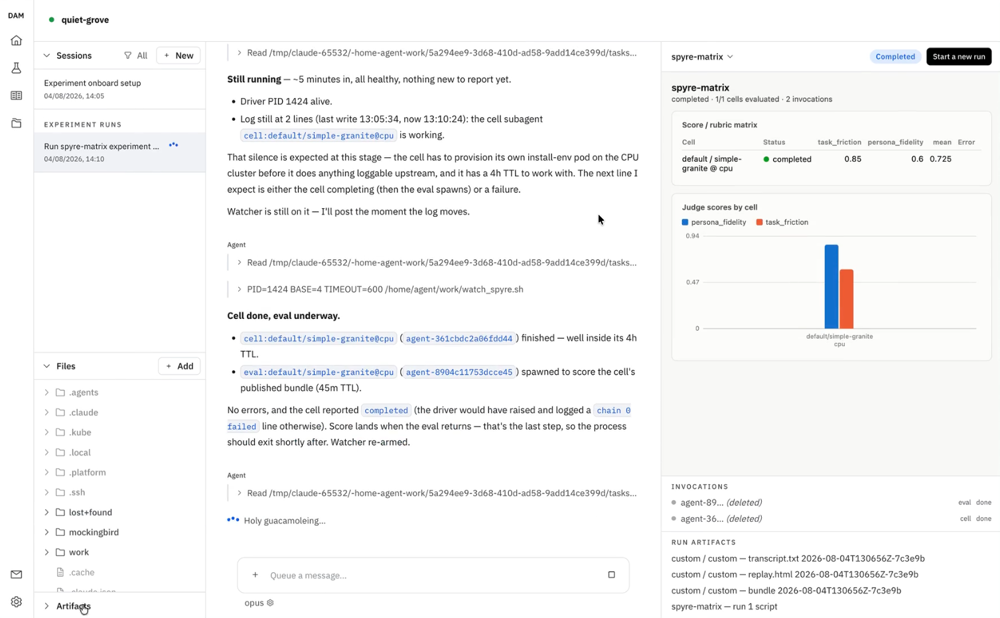
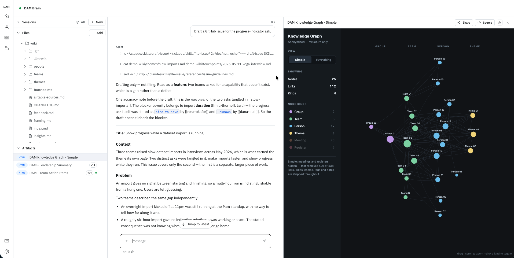

---
hide:
  - toc
---

# IBM Research DAM

Shared infrastructure for AI-native engineering and research — run agent workloads, reuse what others have built, and turn experiments into knowledge the whole organization compounds on.

**Run long-lived AI agents in isolated pods** — with runtime credential injection, scheduled triggers, and Slack-native access.

[Launch DAM →](https://ibm.biz/dam-agents){:target="_blank" .md-button .md-button--primary}
[Join the waitlist](https://ibm.biz/dam-waitlist){:target="_blank" .md-button}

<small class="vpn-note">If you're outside an IBM office, VPN is required</small>

## The problem

Researchers across IBM have built impressive engines — pipelines, harnesses, automations. But each tends to solve one team's problem, on one laptop. Harnesses run locally and interactively; there's nowhere common to share results or the setups that produced them; and working against real systems means credential and network risk each researcher manages alone. Adoption stays uneven, and almost none of it compounds.

## What DAM gives you

### One place to run

Every agent runs isolated, credentialed, and autonomous on shared infrastructure — no more one-off setups on a laptop each. Approvals and egress rules govern what it can reach, so working against real systems stops being a risk you manage alone.

### Reuse, don't rebuild

Agentic best practice comes packaged as connections, skills, and templates — set up once, then reused by anyone. Sessions, schedules, and channels attach to an agent; artifacts come out of it and outlive it.

## What you learn, compounds

Experiments, knowledge bases, and artifacts capture what worked — so the next person starts from it instead of from scratch. Give an agent something to optimize and watch it design and run the loop live; ask a question and get a synthesized answer with citations back to the source.

  <figure>
    
    <figcaption>Experiments — every stage, score, and candidate as it happens.</figcaption>
  </figure>
  <figure>
    
    <figcaption>Knowledge bases — synthesized answers, cited back to the source.</figcaption>
  </figure>

---

## Meet it where you work

- **Web UI** Chat with your agent, stream its terminal, and manage files — all from the browser.
- **CLI** Create agents, attach to live sessions, and manage them from your local terminal.
- **Slack** Invite the DAM bot, run `/dam bind`, and the whole channel can work with your agent.
- **VS Code/Zed** Open your agent's workspace over `dam ssh`.
- **Schedules** Run agents on a recurring timer — daily reviews, nightly audits, continuous monitoring.

---

## Comes with the platform

A choice of coding agents, ready-to-run experiment and knowledge base agents, optimization frameworks, and integrations for Slack, Telegram, and VS Code/Zed — available with no setup of your own. See **[The building blocks](core-concepts/building-blocks.md)** for the full set of reusable pieces, or **[Agents](core-concepts/agents.md)** for the harnesses and frameworks you can run.

## Get started

New here? Start with **Welcome** for the whole picture in one place — what DAM is, why it exists, and how to sign up. Ready to build? Jump straight to the Quickstart.

[Start with Welcome →](getting-started/welcome.md){: .md-button .md-button--primary}
[Quickstart](getting-started/quickstart.md){: .md-button }
[The building blocks](core-concepts/building-blocks.md){: .md-button }

